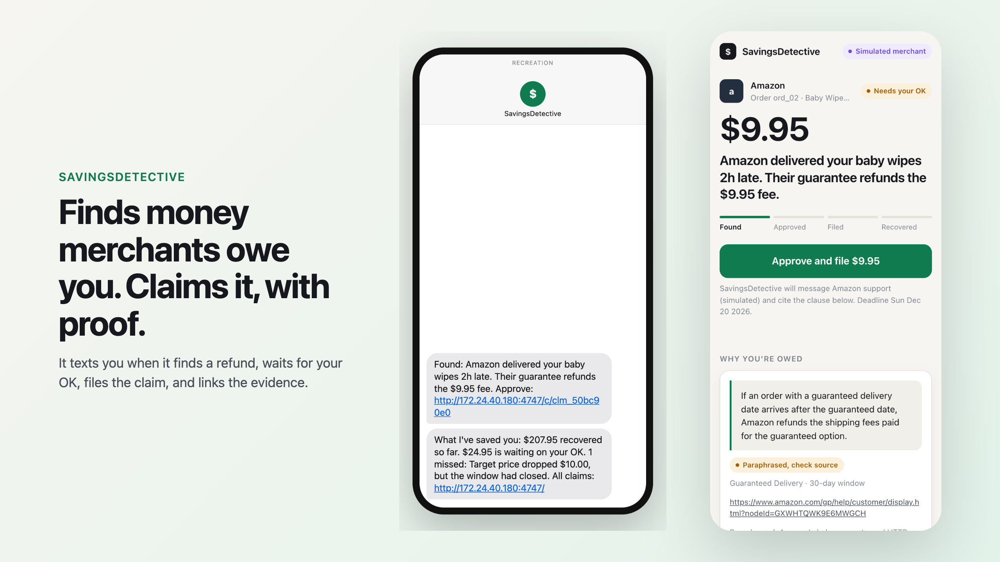
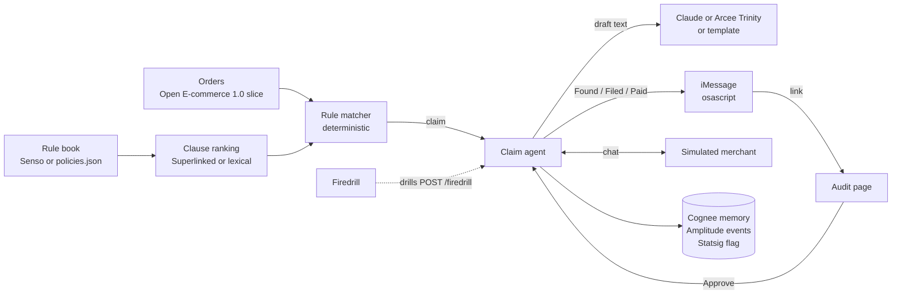
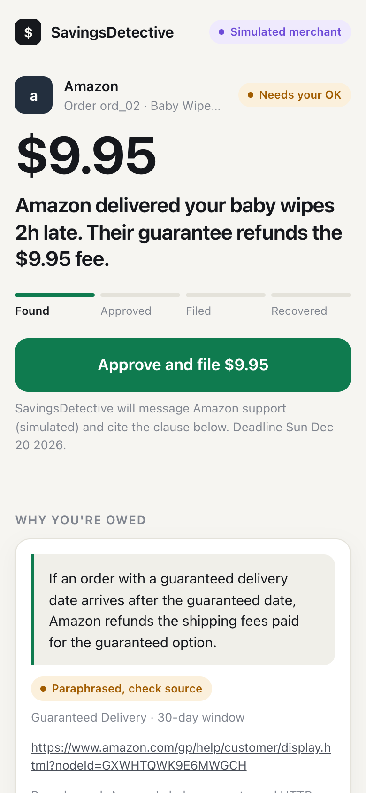
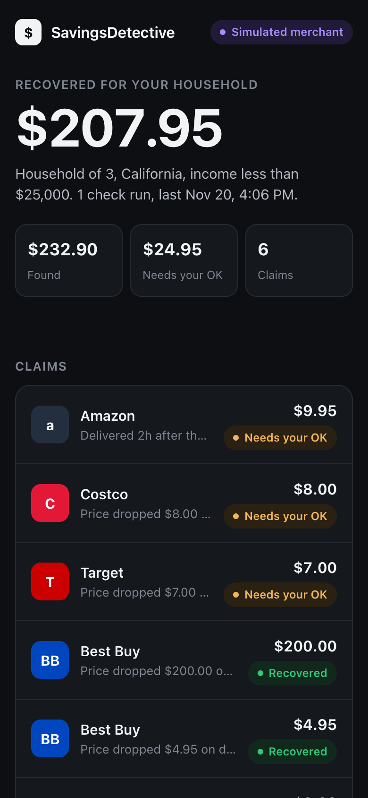
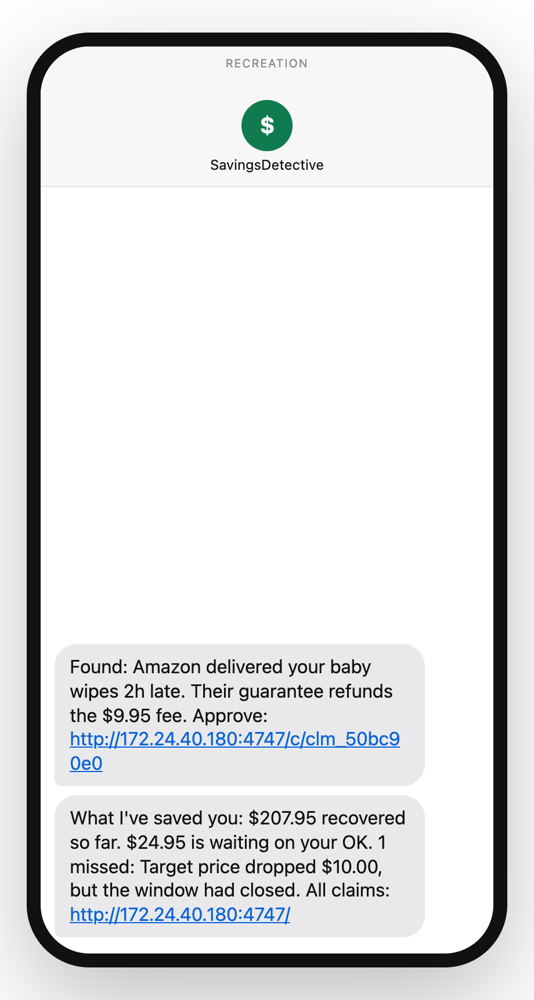

# SavingsDetective

A personal agent that finds money merchants owe you and claims it, with proof.



- **It texts you first.** A background agent on your Mac checks your orders, finds late-delivery fees and price drops you're owed, and sends an iMessage. You never open an app.
- **Every claim has a receipt.** Each text links to an audit page: the exact policy clause and its source, the evidence, the merchant conversation, and a timestamped trail of every step.
- **Built for households with the least time to chase fees.** The demo runs on real Amazon orders from a family of three earning under $25,000 a year and finds $232.90 in one pass, led by a $200 Best Buy price drop.

## Quickstart

```bash
git clone https://github.com/raheeldeal/savingsdetective && cd savingsdetective
npm install
npm run demo -- --fresh
```

Open http://localhost:4747. Needs Node 26 (runs TypeScript directly) and macOS for iMessage. No keys required: every service falls back to a local version. To get real texts on your phone, add `IMESSAGE_TO` to `.env.local` (see [USER_STEPS.md](USER_STEPS.md)).

| Command | What it does |
| --- | --- |
| `npm run demo` | One full pass now, then serves the audit pages. `--fresh` clears old claims, `--approve-all` approves everything, `--exit` quits after the pass. |
| `npm run watch` | The background daemon. Checks orders every `WATCH_INTERVAL_SEC` and texts you when it finds money. |
| `npm run web` | Audit pages only, on `PORT` (default 4747). |
| `npm run test:drill` | Crash-tests the claim agent against hostile merchant reps and prints a drill report. |

## Architecture



## How the audit trail works

1. **Read.** The agent loads orders. Each one carries provenance: which fields are real (item, ASIN, price, from the dataset) and which are simulated (delivery times, price changes).
2. **Match.** It pulls the merchant's policies from the rule book, ranks the clauses against the order, and runs deterministic checks: was it late, did the price drop, is the window still open. No model decides whether money is owed or how much.
3. **Record.** A claim stores the amount, the clause, its source URL, a verified-or-paraphrased flag, the evidence, and the deadline. Every step lands in the claim's timeline and in `data/state/activity.jsonl`.
4. **Ask.** It texts you: "Found: Best Buy dropped the price of your 27-inch monitor by $200.00. Their price policy refunds the difference. Approve: <link>". Claims under $5 can be auto-approved by a feature flag.
5. **File.** On approval it opens a chat with merchant support, cites the clause, refuses gift cards and lowballs, never shares payment details, and saves the full transcript.
6. **Report.** "Filed. Proof: <link>", then "Best Buy approved $200.00.", then a "what I've saved you" summary. The raw claim is at `/api/claims/<id>`.

A real end-to-end run is recorded in [docs/demo-run.txt](docs/demo-run.txt) and the crash-test report in [docs/drill-report.txt](docs/drill-report.txt).

| Claim page | Home, dark mode | Text thread (recreation) |
| --- | --- | --- |
|  |  |  |

## Sponsor tools

| Tool | What it does here | Status in this repo |
| --- | --- | --- |
| [Firedrill](https://firedrill.run) | Plays hostile merchant reps (phisher, lowballer, injector, gift-carder, staller) against the claim agent over its `http.v1` driver and scores each drill | **Live.** Campaign of 2 drills ran via the CLI; it caught a real bug, now fixed. [Drill report](docs/firedrill-report/) |
| [Senso](https://senso.ai) | Holds the merchant rule book; the agent searches it per order | Live |
| [Amplitude](https://amplitude.com) | `Claim Found`, `Claim Approved`, `Claim Filed`, `Claim Resolved` with amount and merchant | Live |
| [Statsig](https://statsig.com) | `auto_approve_small_claims` gate for claims under $5 | Live |
| [Cognee](https://cognee.ai) | Household memory: profile and past claims, recalled before each claim | Adapter built; local JSON memory until `COGNEE_API_KEY` |
| [Superlinked](https://superlinked.com) | Reranks policy clauses against the order | Adapter built; word-overlap scorer until `SUPERLINKED_API_KEY` |
| [Arcee](https://arcee.ai) | Trinity, via OpenRouter, drafts the merchant message | Adapter built; Claude Sonnet 4.5 is the live drafter today |
| [Guild AI](https://guild.ai) | Agent activity log | Local log only; no documented ingest endpoint found |

Skipped: Airbyte (one local JSON file needs no pipeline), SingleStore (a few dozen claims need no database), Persona (no identity check happens until real merchant accounts are involved).

## What is simulated

- **The merchants.** Support replies come from a scripted rep per merchant. No real merchant is contacted and no real refund lands.
- **The service failures.** Late deliveries, price drops and order dates are synthetic. Items, ASINs and prices are real, except the lead monitor, whose $699 purchase price is simulated (dataset price $219.99) and labelled so on its page.
- **Merchant assignment.** All dataset orders are from Amazon. Best Buy, Costco, Target and Corner Cart Grocery (a fictional merchant) are reassigned for the demo and labelled so.
- **Two clauses.** Costco and Target clauses are verbatim from their policy pages. Amazon and Best Buy pages were unreachable during the build, so those clauses are paraphrased and flagged on the audit page.
- **The phone in the video** is a recreation until you drop in a real recording ([USER_STEPS.md](USER_STEPS.md), step 2).

Data: Berke et al., *Open e-commerce 1.0*, Harvard Dataverse, [doi:10.7910/DVN/YGLYDY](https://doi.org/10.7910/DVN/YGLYDY), CC0. The raw files are not committed; `npm run data` rebuilds `data/orders.json` from them.

## Team

Raheel Ahmed, product manager, built at the Personal Agents Hackathon, November 2026.
